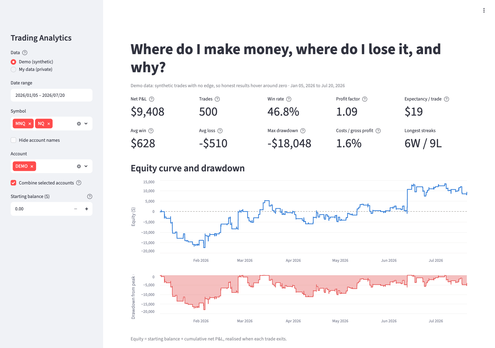
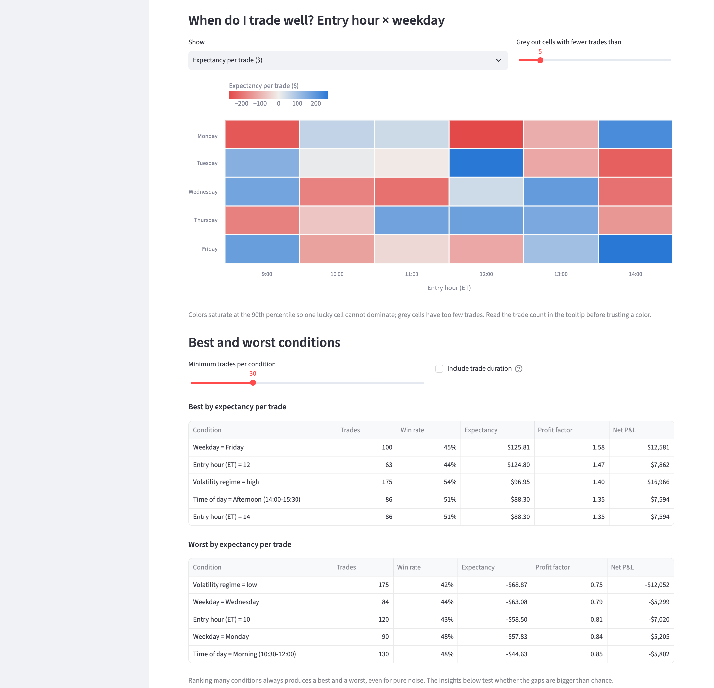
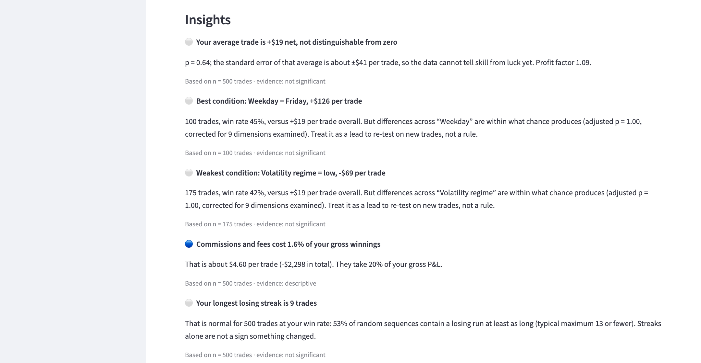
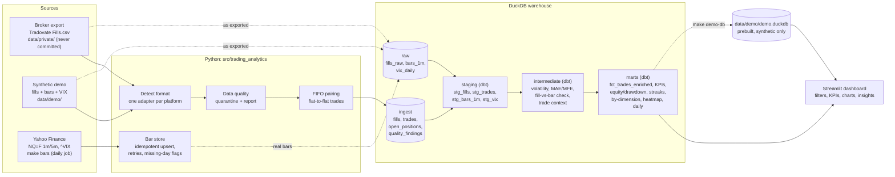
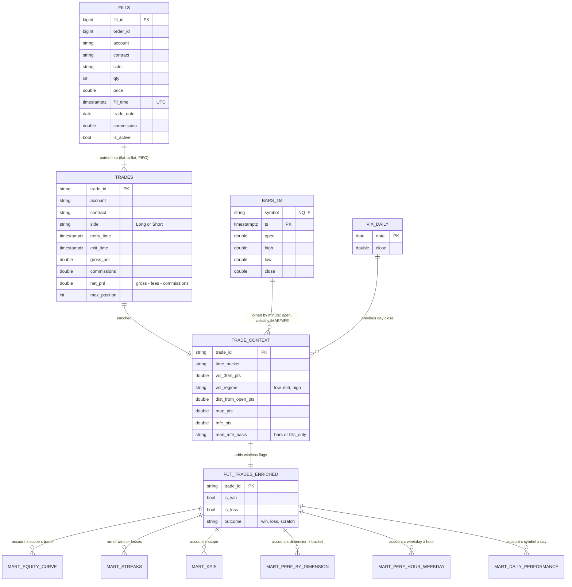

# Trading Performance Analytics Pipeline

**Where do I make money, where do I lose it, and why?**

An end-to-end data pipeline for futures day-trading: it ingests a broker's fill export (Tradovate
`Fills.csv`, NQ/MNQ), cleans and pairs the fills into round-trip trades, enriches each trade with
market context (volatility, VIX, distance from the open, MAE/MFE from 1-minute bars), models
everything in SQL (DuckDB + dbt), and serves a Streamlit dashboard with statistically guarded
insights.

> **The public demo runs on synthetic data with no edge built in**, so it shows noise, not skill.
> That is deliberate (see [Key decisions](#key-decisions)). The same code runs on real fills; those
> never leave the author's machine (`data/private/` is git-ignored and guarded in CI).



<details>
<summary>More screenshots (demo data)</summary>





</details>

## What it does

| Question | Where it is answered |
|---|---|
| How am I doing overall? | KPI cards: net P&L, win rate, profit factor, expectancy, avg win/loss, max drawdown, costs as % of gross, streaks |
| What is the shape of my results? | Equity curve and drawdown chart (monthly ticks, realised at each trade's exit) |
| When do I trade well? | Entry hour × weekday heatmap; best/worst conditions by session, volatility regime, VIX regime, side, symbol |
| Is any of that real? | Insights: permutation tests, corrected for the number of slicings examined; every finding states its `n` |
| Can I trust the data? | A data quality report of everything that was excluded or doubted, plus a fill-vs-bar price check |

## Architecture



**Layers.** `raw` is what was exported or fetched, never modified. `ingest` is what Python
produced (cleaned fills, paired trades), because pairing is stateful and awkward in SQL.
`staging` → `intermediate` → `marts` are dbt models: every analytical number is SQL.
The deployed demo reads a prebuilt synthetic `demo.duckdb`, so it needs neither dbt nor Yahoo at runtime.

## Data model



Grain of each mart: `fct_trades_enriched` = trade; `mart_equity_curve` = account × symbol scope ×
trade; `mart_streaks` = streak; `mart_kpis` = account × symbol scope;
`mart_perf_by_dimension` = account × dimension × bucket; `mart_perf_hour_weekday` = account ×
weekday × hour; `mart_daily_performance` = account × symbol × trade date (additive, so any date
filter re-aggregates exactly).

## Supported platforms

| Platform | Export | Status |
|---|---|---|
| Tradovate (incl. prop firms such as Lucid Trading) | `Fills.csv` | supported, verified on real fills |
| NinjaTrader, Rithmic, TopstepX | fills / trades CSV | not yet: add one adapter file |

The format is auto-detected from the CSV headers. A new platform is one adapter
(`src/trading_analytics/ingest/adapters/`), one fixture and one test; everything downstream works
on the canonical schema.

## How to run

Requirements: Python 3.12 and [uv](https://docs.astral.sh/uv/). Docker is optional.

```bash
make setup        # install everything (incl. dbt and the Yahoo client) + enable the git hook
make all          # lint, ingest, dbt build (models + tests), pytest, on the synthetic demo
make dashboard    # open the dashboard at http://localhost:8501
```

On your own trades (never leaves your machine):

```bash
# 1. put your export at data/private/Fills.csv   (git-ignored)
# 2. optional: data/private/expected.yaml = the totals your platform shows (template:
#    docs/expected.example.yaml); `make all` then fails loudly if the pipeline disagrees
make all DATASET=private
make dashboard                       # pick "My data (private)" in the sidebar
make bars                            # run daily: accumulate real 1-minute bars (see Limitations)
```

| Command | What it does |
|---|---|
| `make ingest [DATASET=private]` | clean + pair fills, load the DuckDB warehouse |
| `make transform [DATASET=private]` | `dbt build`: all models and their tests |
| `make test` / `make lint` | pytest (incl. the private-data guard) / ruff |
| `make reconcile` | compare computed trades with `data/private/expected.yaml` |
| `make quality [FILE=...]` / `make quality-demo` | data quality report |
| `make bars` | fetch and accumulate Yahoo bars (idempotent, retries, missing-day flags) |
| `make demo-data` / `make demo-db` | regenerate the synthetic export / the committed demo database |
| `make docker-build` / `docker-run` / `docker-smoke` | the dashboard image |
| `make cloud-check` | run the app in an environment with only `requirements.txt` |

**Docker** (serves the synthetic demo; no private data can enter the image):

```bash
make docker-build && make docker-run        # http://localhost:8501
# to view your own warehouse inside Docker, mount it read-only:
docker run --rm -p 8501:8501 \
  -v "$PWD/data/warehouse/private.duckdb:/app/data/warehouse/private.duckdb:ro" trading-analytics
```

## Deploy the demo on Streamlit Community Cloud

The demo needs no secrets, no dbt and no Yahoo: it reads the committed synthetic
`data/demo/demo.duckdb`. In the browser:

1. Push this repository to GitHub (public repositories deploy for free).
2. Go to <https://share.streamlit.io> and sign in with GitHub (allow access to the repository when asked).
3. Click **Create app** → **Deploy a public app from GitHub**.
4. Fill in: **Repository** `<your-user>/trading-analytics`, **Branch** `main`, **Main file path**
   `src/trading_analytics/dashboard/app.py`. Optionally pick a custom URL under **App URL**.
5. Open **Advanced settings** and choose **Python 3.12**. Leave **Secrets** empty.
6. Click **Deploy**. The first start installs `requirements.txt` (about a minute).
7. If the app ever shows stale data after you change the demo, run `make demo-db`, commit, and
   push (Cloud redeploys on every push); use **⋮ → Reboot app** to restart it manually.

Before deploying, `make cloud-check` runs the app in a clean environment containing only
`requirements.txt`, which is what Cloud installs.

## Key decisions

- **A trade is a flat-to-flat position per (account, contract)**, with FIFO lots inside it for
  P&L. This matches how the platform counts trades. NQ and MNQ are separate positions, partial
  fills and scale-in/out stay inside one trade, a flip closes at the zero crossing and the rest
  opens a new trade, and a position still open at the end of the data is reported, never closed
  with an invented exit.
- **Gross vs net are separate columns.** `net = gross − fees − commissions`. Like the platform,
  the headline net P&L is net, while avg win, avg loss and profit factor are gross; win/loss
  classification is configurable (`win_loss_basis`).
- **UTC only.** The platform's UTC timestamp is the only stored time; exchange, ET and Israel time
  are derived, because US and Israeli daylight-saving dates differ and a hard-coded offset is
  wrong for several weeks a year.
- **Quarantine and report, never silently fix.** Duplicates, blank fields, off-tick or absurd
  prices and inactive fills are excluded and listed in a data quality report (see the
  [sample](docs/data_quality_report_demo.md)); nothing is imputed. Excluding a fill can desync
  position tracking, so that raises its own warning.
- **One source of truth for metrics.** Every metric is defined once, in dbt macros
  (`dbt_project/macros/metrics.sql`). The dashboard does not re-implement them: it renders the
  real mart SQL over the filtered trades, so a filter changes *which* trades are aggregated, never
  *how*. A test proves the unfiltered result equals the dbt-built marts exactly.
- **No planted edge in the demo.** The synthetic trader's direction is a coin flip, stops and
  targets scale with volatility, and prices are a driftless random walk, so expected gross P&L is
  zero in every hour, weekday and volatility regime. Permutation tests verify it (including a test
  that plants an edge to show the checks can detect one), so the dashboard cannot "discover"
  something the author put there.
- **Permutation tests in the Insights.** Any ranking of conditions produces a best and a worst,
  even from noise. Insights test each dimension with a permutation test, correct for the number
  of dimensions examined, and say "within what chance produces" when a gap is not significant.
  Trade duration is excluded as a "when to trade" condition: it is only known after the trade and
  is mechanically tied to the outcome.
- **No look-ahead in the context.** Volatility is measured on the 30 one-minute changes *before*
  the entry minute, VIX is the previous day's close, and regime thresholds come from the
  distribution over all regular-hours bars, not from splitting your trades into thirds (which
  would force any 9 trades into 3/3/3).

## Verification

- **Reconciled against the broker's own numbers on real fills.** The pipeline was run on the
  author's real Tradovate (Lucid Trading) fill export and compared with the totals the platform's
  own dashboard shows (net P&L, trade counts, win rates and averages, per day and per symbol)
  through `make reconcile`, which fails loudly on any mismatch. Those figures are private and are
  not published here; the repository's tests use synthetic fixtures only.
- **Metrics are tested against independent computations.** Every KPI, dimension bucket, heatmap
  cell, daily row and the equity/drawdown path is recomputed in pandas/numpy and compared with
  the SQL, and a hand-computed 9-trade fixture checks exact values.
- **dbt tests** (grain uniqueness, consistency between marts, no look-ahead) run on every build.
- **Provenance of the committed demo database.** A test fails if `data/demo/demo.duckdb`
  contains anything not derived from `data/demo/` or is stale.
- **Private-data guard.** `scripts/check_no_private.py` runs as a pre-commit hook, in `make test`
  and in CI; it blocks everything under `data/private/` and `data/warehouse/`, every database
  except the synthetic demo, and any data file with "private" in its path. The Docker build
  context is an allow-list.
- **CI** (GitHub Actions) runs lint, the guard and the tests, builds and smoke-tests the Docker
  image, and runs the app in a requirements-only environment, on every push.

## Limitations and future work

- **Yahoo's 1-minute window is short.** Yahoo serves roughly 7 days of 1-minute and about 60 days
  of 5-minute bars. The pipeline therefore needs a **daily `make bars` job** that accumulates bars
  into the warehouse (idempotent, with retries and missing-day flags). A day that is missed and
  falls outside the window can never be refilled; the coverage table marks such days as
  unrecoverable. MAE/MFE and volatility are only available for trades covered by stored bars.
- **MNQ trades use NQ bars as a proxy.** They track the same index; only the multiplier differs.
  Tick-level differences between the two contracts are ignored.
- **Basis between the continuous NQ=F and a specific contract.** Yahoo's `NQ=F` is a continuous
  series; fills are on a specific month (e.g. NQZ6). The fill-vs-bar check assumes no basis unless
  most of a contract-day's fills fall outside their bars, then removes the estimated basis and
  flags fills more than 5 points away. Around rolls this is approximate.
- **The holiday calendar is hand-kept** (`src/trading_analytics/market/sessions.py`, currently
  2026 into early 2027) and **needs a yearly update**, including early closes. A wrong entry can
  mislabel a day as missing or not.
- **`vol_regime` thresholds are recomputed on every build** from all bars in the store, so they
  move as bars accumulate and a trade's regime can change between runs. A future improvement is
  to **freeze a reference window** (store the thresholds and the date range they were computed on)
  so regimes are stable and comparable over time.
- **An export that starts mid-position is not detected.** If the first fill in the file closes a
  position opened before the export began, it is read as opening a new one. Starting exports from a
  flat state avoids it.
- **ES is not fetched by default.** The target list covers NQ=F and ^VIX because that is what is
  traded; adding ES/MES is one line in the default targets plus a calendar check.
- **Demo shows noise, not skill.** The synthetic trader has no edge by construction: its realised
  P&L in any sample is luck. Do not read the demo's numbers as performance; read the *method*.
- Smaller notes: the CME session-date rule (rolls at 18:00 ET) is an assumption checked by a
  warning on real data; MAE/MFE from 1-minute bars are bounds (the entry-minute bar is excluded,
  the exit-minute bar included); marts are per account (no cross-account roll-up in SQL; the
  dashboard can combine accounts); one platform adapter so far.

## Project layout

```
src/trading_analytics/
  ingest/      adapters (one per platform), format detection, schema, FIFO pairing, reconciliation
  quality/     checks, report, timezone helpers
  market/      Yahoo fetch with retries, idempotent bar store, coverage flags, session calendar
  demo/        synthetic trader (no edge), synthetic bars/VIX, defect injection
  dashboard/   Streamlit app, charts, insights, filtered-mart SQL rendering
  warehouse.py loads raw/ingest schemas into DuckDB for dbt
dbt_project/   staging -> intermediate -> marts, macros (metric definitions), seeds, tests
data/demo/     synthetic export, bars, VIX, prebuilt demo.duckdb (the only database in git)
tests/         pytest (SQL metrics vs pandas oracles, quality, matching, dashboard, guards)
scripts/       CLI entry points, privacy guard, screenshot and smoke-test helpers
```

Built with Python 3.12, DuckDB, dbt-duckdb, Streamlit, Altair, pytest, ruff, Docker and GitHub Actions.
